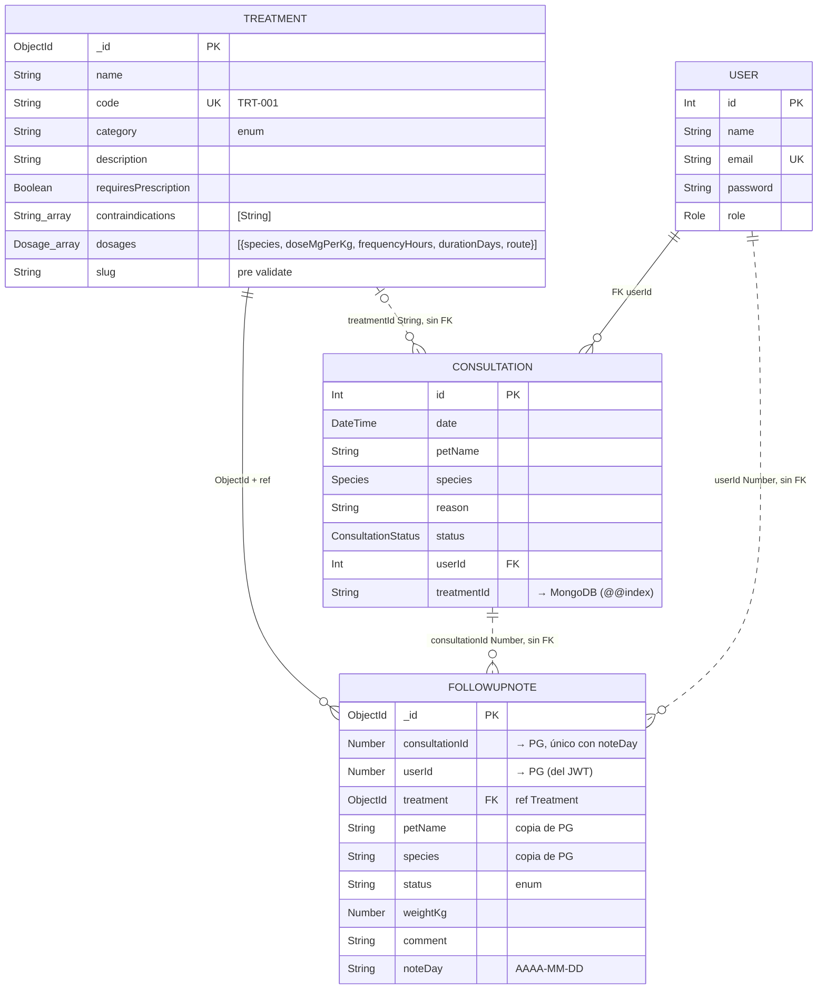

# Tarea individual U2 · Modelo híbrido PostgreSQL + MongoDB

**Estudiante:** José Villa  **N.º de lista:** 7 (asignado por el docente)  **Caso:** 7 · Veterinaria

> Mismo formato que el workload del material de Modelado (lección 2.2: *Use Cases, Main Data, Assumptions,
> Operations, Entities, Observations*) y que el ejemplo resuelto de la clínica. Cada operación agrega la fila **Base**.

| Pieza del caso | Dónde vive | Nombre en el código |
|---|---|---|
| Consulta (mascota, fecha) | PostgreSQL | `Consultation` (Prisma) |
| Tratamiento (dosis por especie[]) | MongoDB · catálogo | `Treatment` (colección `treatments`) |
| Nota de seguimiento | MongoDB · registro que crece | `FollowUpNote` (colección `followupnotes`) |

---

## 1. Workload

### 1.1 Casos de uso

- Una veterinaria de barrio atiende perros, gatos, aves, conejos y reptiles. El dueño de la mascota tiene una cuenta
  (login con JWT) y registra la **consulta** de su mascota: fecha, nombre de la mascota, especie y motivo.
- En la consulta se asigna un **tratamiento** del catálogo. La **dosis depende de la especie**: el mismo
  antiparasitario se da en mg/kg distintos a un perro que a un gato, y a veces no existe dosis para una especie.
- Mientras dura el tratamiento, el dueño reporta desde casa una **nota de seguimiento diaria** (estado, peso,
  comentario). El veterinario revisa la evolución de la mascota leyendo esas notas.
- El dueño ve su historial de consultas con el nombre del tratamiento y la dosis que le corresponde a su mascota.
- El administrador mantiene el catálogo de tratamientos y consulta estadísticas de evolución por tratamiento.

### 1.2 Datos principales (cuántos actores, cuántos registros, cuánto tiempo se guardan)

- Dueños registrados: ~3 000 (crecen ~60 por mes). Mascotas: ~4 500.
- Veterinarios: 5 · Administradores: 1.
- Tratamientos en el catálogo: ~120, cada uno con dosis para 1 a 5 especies.
- Consultas: ~80 por día (~29 000 por año).
- Notas de seguimiento: ~60 % de las consultas llevan tratamiento de ~7 días con una nota diaria
  → ~80 × 0,6 × 7 ≈ **330 notas por día**. **Crecen sin límite.**
- Período: consultas y notas se guardan **10 años** (historia clínica veterinaria) → ~290 000 consultas y
  **~1,2 millones de notas**.

### 1.3 Suposiciones (lo que puede cambiar)

- Una mascota de un mismo dueño no tiene dos consultas a la misma fecha y hora (integridad fuerte).
- Una consulta tiene **como máximo una nota por día**; un tratamiento largo puede acumular decenas de notas.
- La dosis de un tratamiento solo cambia cuando cambia el tratamiento completo; las especies cubiertas son pocas (≤ 5).
- Cada tipo de tratamiento tiene campos distintos (las vacunas no tienen contraindicaciones, los antibióticos sí;
  unos son orales y otros inyectables): forma variable.
- El nombre y la especie de la mascota casi nunca cambian: se pueden copiar en la nota.
- Las notas se leen por consulta, las más nuevas primero; las estadísticas por tratamiento se piden pocas veces al día.

### 1.4 Operaciones (9 operaciones, una tabla por operación)

| Actor: | Dueño de la mascota |
|---|---|
| Descripción: | Registra la consulta de su mascota y (opcional) el tratamiento asignado |
| Tipo de operación: | Escritura |
| Datos en la operación: | date, petName, species, reason, treatmentId; userId del JWT |
| Frecuencia: | ~80 por día, picos de 9:00 a 11:00 |
| Tasa: | 80 / día |
| Base: | **PostgreSQL** (transacción, FK a User y unicidad mascota+fecha); lee **MongoDB** para validar `treatmentId` y que tenga dosis para la especie |

| Actor: | Dueño de la mascota |
|---|---|
| Descripción: | Ve su historial de consultas con el nombre del tratamiento y la dosis de su especie |
| Tipo de operación: | Lectura |
| Datos en la operación: | consultas (PostgreSQL) + name, code, category, dosages[especie] (MongoDB) |
| Frecuencia: | cada dueño activo ~1 vez cada 5 días |
| Tasa: | ~600 / día |
| Base: | **Las dos**: se une en el servicio con `$in` + `Map` (2 consultas, sin N+1) |

| Actor: | Veterinario (o dueño) |
|---|---|
| Descripción: | Busca tratamientos del catálogo por nombre o por especie |
| Tipo de operación: | Lectura |
| Datos en la operación: | name, code, category, description, dosages[] |
| Frecuencia: | en cada consulta y cada vez que un dueño revisa el tratamiento |
| Tasa: | ~2 000 / día |
| Base: | **MongoDB** (documento con sus dosis embebidas, listo para mostrar) |

| Actor: | Dueño de la mascota |
|---|---|
| Descripción: | Registra la nota de seguimiento diaria de la mascota |
| Tipo de operación: | Escritura |
| Datos en la operación: | consultationId, status, weightKg, comment; userId del JWT; petName y species copiados de PostgreSQL; treatment copiado de la consulta |
| Frecuencia: | una vez al día por cada consulta en tratamiento |
| Tasa: | ~330 / día (sin límite en el tiempo: ~1,2 M en 10 años) |
| Base: | **MongoDB**, colección propia; lee **PostgreSQL** para validar que la consulta exista (404) y sea suya (403) |

| Actor: | Veterinario |
|---|---|
| Descripción: | Lee la evolución de una consulta: sus notas, más nuevas primero, con el nombre del tratamiento |
| Tipo de operación: | Lectura |
| Datos en la operación: | petName, species, status, weightKg, comment, createdAt + treatment.name (populate) |
| Frecuencia: | cada consulta en tratamiento se revisa ~4 veces al día |
| Tasa: | ~1 500 / día |
| Base: | **MongoDB** solamente (por eso se copian `petName` y `species`) |

| Actor: | Administrador / Veterinario |
|---|---|
| Descripción: | Ve la estadística de evolución de un tratamiento (notas por estado y peso promedio) |
| Tipo de operación: | Lectura (aggregate) |
| Datos en la operación: | treatment, status, weightKg de todas sus notas |
| Frecuencia: | pocas veces al día |
| Tasa: | ~20 / día |
| Base: | **MongoDB** (`$match` + `$group` sobre el índice `{ treatment, createdAt }`) |

| Actor: | Veterinario |
|---|---|
| Descripción: | Cambia o suspende el tratamiento de una consulta |
| Tipo de operación: | Escritura |
| Datos en la operación: | id de la consulta, nuevo treatmentId (o null) |
| Frecuencia: | ~1 de cada 4 consultas en tratamiento |
| Tasa: | ~12 / día |
| Base: | **PostgreSQL**; valida el nuevo `treatmentId` en **MongoDB** |

| Actor: | Administrador |
|---|---|
| Descripción: | Crea o edita un tratamiento con sus dosis por especie |
| Tipo de operación: | Escritura |
| Datos en la operación: | todos los campos del tratamiento y dosages[] |
| Frecuencia: | pocas veces al mes |
| Tasa: | ~10 / mes |
| Base: | **MongoDB** |

| Actor: | Administrador |
|---|---|
| Descripción: | Elimina un tratamiento del catálogo |
| Tipo de operación: | Escritura |
| Datos en la operación: | _id; conteo de consultas que lo usan (PostgreSQL) |
| Frecuencia: | casi nunca |
| Tasa: | ~2 / año |
| Base: | **MongoDB**, revisando **PostgreSQL** (409 si alguna consulta lo usa; si no, borra en cascada sus notas) |

### 1.5 Entidades

- **PostgreSQL**
  - User
    - Consultation (1:N, FK `userId`)
- **MongoDB**
  - Treatment
    - dosages[] (embebido: species, doseMgPerKg, frequencyHours, durationDays, route)
    - contraindications[] (embebido)
    - FollowUpNote (1:N, `treatment` ObjectId + `ref`)
  - FollowUpNote
- **Entre bases (sin FK)**
  - Consultation.treatmentId → Treatment._id (String)
  - FollowUpNote.consultationId → Consultation.id (Number; único junto con el día)
  - FollowUpNote.userId → User.id (Number) · FollowUpNote.petName y species (copias)

### 1.6 Observaciones (qué domina: lectura o escritura, qué crece sin límite, qué necesita integridad)

- Dominan las **lecturas**: ~4 100 lecturas frente a ~420 escrituras al día (≈ 10 a 1). Lo que más se lee
  (catálogo y evolución de la consulta) debe salir de una sola consulta a MongoDB.
- Lo único que **crece sin límite** son las notas de seguimiento (~1,2 M en 10 años): van en su propia colección,
  nunca embebidas en el tratamiento ni en un arreglo (límite de 16 MB por documento).
- La consulta necesita **integridad**: FK a User y que la misma mascota no tenga dos consultas a la misma hora → PostgreSQL.
- La **dosis depende de la especie**: se embebe dentro del tratamiento y la API valida que exista dosis para la especie
  de la mascota antes de asignar el tratamiento.
- `petName` y `species` se copian en la nota porque la evolución se lee ~1 500 veces al día y esos datos casi no cambian.
- Índices que pide el workload: `Consultation(treatmentId)` y `Consultation(userId, date)` en PostgreSQL;
  `followupnotes { consultationId, noteDay }` **único**, `{ consultationId, createdAt: -1 }` y
  `{ treatment, createdAt: -1 }`; `treatments { code }` único y `{ category, name }` en MongoDB.

---

## 2. ¿PostgreSQL o MongoDB?

| Entidad | ¿Transacciones o choques? | ¿Otras dependen por FK? | ¿Forma variable? | ¿Crece sin límite? | ¿Se lee mucho más? | Base |
|---|---|---|---|---|---|---|
| User | Sí: email único, login | Sí: Consultation.userId | No | No (~3 000) | No | **PostgreSQL** |
| Consultation | Sí: una mascota no tiene dos consultas a la misma hora (`@@unique`) | Sí: depende de User por FK | No: siempre fecha, mascota, especie, motivo | Moderado (~29 000/año), se consulta por usuario | No: 80 escrituras / 600 lecturas, necesita consistencia | **PostgreSQL** |
| Treatment (catálogo) | No: lo edita solo el administrador | No (nadie depende por FK; Consultation lo guarda como String) | **Sí**: dosis por especie, contraindicaciones solo en algunos | No (~120) | **Sí**: ~2 000 lecturas frente a ~10 escrituras al mes | **MongoDB** |
| FollowUpNote (registro) | No: cada nota es independiente (solo una por día y consulta → índice único) | No | Algo: peso opcional, comentario libre | **Sí**: ~1,2 M en 10 años | Sí: ~1 500 lecturas frente a ~330 escrituras | **MongoDB** |

## 3. Relaciones dentro de MongoDB: embeber o referenciar

| Relación | Cardinalidad | ¿Se lee junto? | ¿Cambia seguido? | ¿Crece sin límite? | Decisión |
|---|---|---|---|---|---|
| Treatment → dosages | 1 : pocos (≤ 5, una por especie) | Sí: siempre que se muestra o se asigna el tratamiento | No: cambia con el tratamiento | No | **Embeber** `dosages: [Dosage]` |
| Treatment → contraindications | 1 : pocos | Sí | No | No | **Embeber** `contraindications: [String]` |
| Treatment → FollowUpNote | 1 : muchos (miles) | Por partes: las notas se leen por consulta, el tratamiento solo aporta su nombre | Sí: se agrega una nota diaria | **Sí** | **Referenciar** `treatment: ObjectId, ref: "Treatment"` (populate) |
| Consultation → FollowUpNote | 1 : muchos (entre bases) | Por partes | Sí | Sí | **Referenciar** `consultationId: Number` (sin FK, valida el servicio) |

## 4. ERD híbrido (notación pata de gallo)

Línea continua: FK de PostgreSQL o `ref` de Mongoose. **Línea punteada: referencia entre bases (sin FK).**

Zona **PostgreSQL**: `USER`, `CONSULTATION`. Zona **MongoDB**: `TREATMENT` (con `dosages[]` y `contraindications[]`
embebidos) y `FOLLOWUPNOTE`. (El proyecto base de clase conserva además `Appointment` y `TimeBlock` de la Unidad 1,
que no forman parte de este caso.)

## 5. Referencias

| Referencia | Se guarda como | La garantiza | Se une con |
|---|---|---|---|
| Consultation.userId → User.id | `Int` con FK | PostgreSQL (FK `ON DELETE RESTRICT`) | `include` de Prisma |
| Consultation.treatmentId → Treatment._id | `String?` + `@@index` | El servicio: `isValidObjectId` + `Treatment.exists()` (400/404) y que tenga dosis para la especie (400); el borrado del tratamiento responde 409 si se usa | `Treatment.find({ _id: { $in: ids } })` + `Map` |
| FollowUpNote.treatment → Treatment._id | `ObjectId` + `ref: "Treatment"` | Se copia de la consulta ya validada; el borrado del tratamiento borra sus notas en cascada | `populate("treatment", "name code category")` |
| FollowUpNote.consultationId → Consultation.id | `Number` (índice único con `noteDay`) | El servicio con Prisma: `findUnique` (404) y dueño = usuario del token (403); al borrar la consulta se borran sus notas | `prisma.consultation.findUnique` |
| FollowUpNote.userId → User.id | `Number` | Sale del JWT (nunca del body) | No se une: filtra "mis notas" |

## 6. Dato copiado entre bases (desnormalización)

- **Dato:** `petName` y `species` de `Consultation` (PostgreSQL) se copian en cada `FollowUpNote` (MongoDB).
  También se copia la referencia `treatment` vigente en la consulta al momento de escribir la nota.
- **Por qué (operación del workload):** la evolución de una consulta se lee ~1 500 veces al día y la estadística por
  tratamiento agrupa miles de notas; con la copia ambas salen solo de MongoDB, sin ir a PostgreSQL por cada nota.
  Copiar el `treatment` deja registrado qué tratamiento tenía la mascota el día de la nota, aunque después cambie.
- **Costo:** si el dueño corrige el nombre de la mascota en PostgreSQL, las notas antiguas conservan el nombre anterior
  (habría que actualizarlas con `updateMany({ consultationId }, { petName })`). Ocupa unos bytes más por nota
  (~1,2 M notas × ~20 B ≈ 24 MB en 10 años). La especie prácticamente no cambia.

## 7. Endpoints

| Método y ruta | Base(s) | Respuestas posibles |
|---|---|---|
| `POST /api/auth/register` · `POST /api/auth/login` | PostgreSQL | 201 / 200 (token) / 400 |
| `GET /api/treatments?q=&species=&category=&fields=&sort=` | MongoDB | 200 (regex, proyección y orden) |
| `GET /api/treatments/:id` | MongoDB | 200 / 400 (ObjectId inválido) / 404 |
| `POST /api/treatments` (JWT) | MongoDB | 201 / 400 (validaciones en español) / 401 / 409 (código repetido, E11000) |
| `PUT /api/treatments/:id` (JWT, `findById` + `save()`) | MongoDB | 200 / 400 / 401 / 404 |
| `DELETE /api/treatments/:id` (JWT) | MongoDB + PostgreSQL | 200 (`deletedNotes` en cascada) / 401 / 404 / **409** si una consulta lo usa |
| `GET /api/treatments/:id/stats` | MongoDB (aggregate) | 200 / 400 / 404 |
| `POST /api/consultations` (JWT) | PostgreSQL + MongoDB | 201 / 400 (datos, ObjectId, sin dosis para la especie) / 401 / 404 (tratamiento) / 409 (misma mascota y fecha) |
| `GET /api/consultations` (JWT) | PostgreSQL + MongoDB (`$in` + `Map`) | 200 |
| `GET /api/consultations/:id` (JWT) | PostgreSQL + MongoDB | 200 / 400 / 403 / 404 |
| `PATCH /api/consultations/:id/treatment` (JWT) | PostgreSQL + MongoDB | 200 / 400 / 403 / 404 |
| `DELETE /api/consultations/:id` (JWT) | PostgreSQL + MongoDB | 200 (`deletedNotes`) / 403 / 404 |
| `POST /api/notes` (JWT) | MongoDB + PostgreSQL | 201 / 400 / 401 / 403 (no es su consulta) / 404 (consulta) / **409** (ya hay nota hoy, E11000) |
| `GET /api/notes?consultationId=&treatment=&status=&sort=` (JWT) | MongoDB (populate) | 200 / 400 |

## 8. ¿Qué pasa si una de las dos bases falla a la mitad?

No hay transacción distribuida entre PostgreSQL y MongoDB (el contenedor de Mongo es *standalone*, sin réplica).
Por eso cada operación ordena sus pasos para que, si falla la segunda base, quede el estado **menos dañino**:

| Operación | Paso 1 | Paso 2 | Si falla el paso 2 |
|---|---|---|---|
| Crear consulta | Lee MongoDB (`exists`) | Escribe PostgreSQL | No se guarda nada; si Mongo está caído responde 500 y la consulta no se crea con un id sin validar |
| Crear nota | Lee PostgreSQL (`findUnique`) | Escribe MongoDB | No queda nota; si PostgreSQL está caído no se puede validar y no se escribe |
| Borrar tratamiento | Lee PostgreSQL (`count`) y borra el tratamiento | Borra sus notas (`deleteMany`) | Quedan notas con `treatment` apuntando a nada (`populate` devuelve `null`); se limpian repitiendo el `deleteMany` |
| Borrar consulta | Borra en PostgreSQL | Borra sus notas en MongoDB | Quedan notas huérfanas (se limpian con un script); al revés se perderían notas de una consulta que sigue viva |

Riesgo restante: entre el `count` y el borrado de un tratamiento alguien podría crear una consulta que lo use
(condición de carrera). Con ~2 borrados al año se acepta; la solución sería una marca `active: false` antes de borrar.
